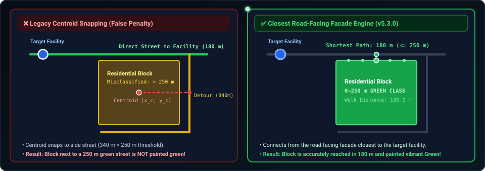
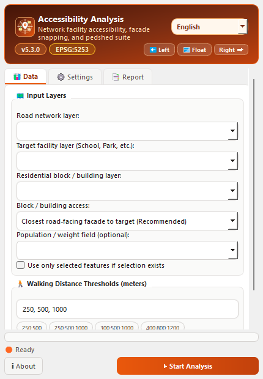

<div align="center">



<br/>

# 🎯 Accessibility Analysis (`v5.3.0`)
### *High-Precision Urban Network Accessibility, Closest Road-Facing Facade Snapping, 15-Minute City Isochrones & Pedshed Suite for QGIS 3 & QGIS 4*

[](https://plugins.qgis.org/)
[](https://www.qt.io/)
[-10b981.svg?style=for-the-badge)](https://epsg.io/5253)
[](#🌍-5-language-runtime-interface)
[](LICENSE)

[](https://doi.org/10.1287/opre.12.3.450)
[](https://doi.org/10.1287/opre.16.5.955)
[](https://doi.org/10.2747/0272-3638.18.6.521)
[](https://doi.org/10.1016/j.healthplace.2005.11.001)
[](https://doi.org/10.1007/bf01386390)

**Author / Developer:** [Baran Adsuna](https://github.com/baranadsuna) • Dokuz Eylül University, Department of Urban and Regional Planning  
**Documentation Portal:** [https://baranadsuna.github.io/yesil_alan_erisimi](https://baranadsuna.github.io/yesil_alan_erisimi)

</div>

---

## 🌟 Why Accessibility Analysis?

**Accessibility Analysis** is an all-in-one urban network walkability, 15-minute city, pedshed, and P-median facility capacity analyzer for **QGIS 3.22+ and QGIS 4.x (Qt5 & Qt6)**.

Whether you are evaluating **Schools, Parks & Green Spaces, Healthcare Centers, Public Transit Stops, or Emergency Assembly Areas**, conventional GIS buffer tools and centroid-only network tools often produce severe spatial distortions on large urban blocks. **Accessibility Analysis** solves these real-world urban planning challenges out of the box:

<div align="center">

</div>

### 🔥 Key Innovations in `v5.3.0`
1. **🔵 Prominent Blue Target Facility Symbology (`#2563EB`)**:
   - Every evaluated target facility (Point or Polygon) is rendered at the **very top of the output layer hierarchy** with a prominent, high-contrast **Blue Circle Marker (`#2563eb`, size `5.6 mm`, white halo outline)** plus an optional translucent blue footprint polygon (`#3b82f6`), ensuring target facilities stand out unmistakably over green/yellow/red accessibility zones.
2. **🏢 Closest Road-Facing Facade Snapping (`evaluate_building`)**:
   - Instead of snapping from a residential block's geometric center (`centroid`)—which can accidentally snap to a back street and add `+150 m` of false detour—the engine samples every `5 m` along all facades of each residential block/building and connects from the **road-facing facade that yields the shortest street-network walking distance to the target facility**.
3. **🟩 Colored Residential Block Polygons & Non-Overlapping Isochrones**:
   - Directly colors reached residential blocks and buildings in **Vibrant Green (`#16a34a`, `0–250 m`)**, **Lime (`#65a30d`)**, **Amber (`#eab308`, `250–500 m`)**, and **Red (`#dc2626`, Unreached)**.
   - Automatically removes small interior block courtyard holes and subtracts inner isochrone rings (`disp_geom.difference(prev_iso_geom)`) so outer yellow/red rings never muddy the inner `0–250 m` green catchment.
4. **🛣 Automatic Planar Road Noding & T-Junction Gap Healing**:
   - Automatically splits intersecting street lines (`node_crossings=True`), heals `<= 15 m` digitizing undershoots and local T-junction gaps (`only_disconnected=False`), and connects polygon facilities to **all surrounding streets within `<= 35 m` frontage**.
5. **🪟 Smooth `18 px` Low-Threshold Dock & Float Controls**:
   - Features a clean Terracotta/Amber architectural UI with one-click **`[⬅ Left | 🪟 Float | Right ➡]`** header buttons and a tight `18 px` outer-edge snap threshold so the floating window never snaps aggressively while dragging across the screen.

---

## 🖥️ User Interface & Multilingual Support

<table>
<tr>
<td width="45%" align="center">

<br/>
<sub><b>Figure 1:</b> 100% English Default Interface (<code>v5.3.0</code>) with 5-language selector and quick dock/float controls.</sub>
</td>
<td width="55%" valign="top">

### 🌍 5-Language Runtime Interface
While all plugin metadata, menus, code, and default startup settings are **100% English**, the top-right dropdown switches the entire interface, layer names, and HTML audit reports instantaneously across **5 languages**:
- 🇬🇧 **English** (`en` — *Default*)
- 🇹🇷 **Türkçe** (`tr`)
- 🇨🇳 **简体中文** (`zh` — *Simplified Chinese*)
- 🇪🇸 **Español** (`es` — *Spanish*)
- 🇮🇩 **Bahasa Indonesia** (`id` — *Indonesian*)

### 📦 Generated Output Layers (Grouped Automatically)
1. 🔵 **`Target Facility Allocation Summary`** *(Top Layer — Prominent Blue Point `#2563eb`, `5.6 mm` + Polygon footprint)*
2. 🟢 **`Accessibility Points (Block / Building)`** *(Categorized by distance threshold)*
3. 🟩 **`Accessibility Polygons (Block / Building)`** *(Residential blocks colored Green / Amber / Red)*
4. 🛣️ **`Service Roads – {T} m`** *(Exact mid-street clipped network lines per threshold)*
5. 🌐 **`Walking Isochrones – {T} m`** *(Non-overlapping clean pedestrian catchment rings)*
6. ⭕ **`Euclidean Buffers – {T} m`** *(Dashed circular benchmark buffers)*
7. 🔍 **`Audit Layers`** *(Facade-to-Road Connectors, Repaired Network Bridges, Facility Access Points)*

</td>
</tr>
</table>

---

## 📐 Mathematical Formulation

### 1. Closest Road-Facing Facade Shortest Path
For a residential block or building $B_i$ with boundary perimeter $\partial B_i$ sampled at $5\text{ m}$ intervals $\mathcal{F}_i = \{f_1, f_2, \dots, f_m\}$ and candidate road segments $e = (u, v) \in \mathcal{E}$ within snap radius $R_{\max}$:

$$d_{\text{walk}}(B_i, \mathcal{J}) = \min_{f_k \in \mathcal{F}_i} \;\min_{e=(u,v) \in \mathcal{E}(f_k)} \Big( \min\big(d(u) + \alpha L_e,\; d(v) + (1-\alpha)L_e\big) + \gamma \cdot \|f_k - \pi_e(f_k)\|_2 \Big)$$

where $\pi_e(f_k)$ is the orthogonal projection of facade point $f_k$ onto street edge $e$ at fraction $\alpha \in [0, 1]$, and $\gamma \in \{0, 1\}$ controls whether the lateral setback offset is added (`0` by default in facade mode).

### 2. Exact Mid-Street Edge Truncation
Boundary street segments $(u, v)$ of length $L_e$ are clipped at the exact metric threshold budget $T$:

$$f_u = \max\left(0, \min\left(1, \frac{T - d(u)}{L_e}\right)\right), \quad f_v = \max\left(0, \min\left(1, \frac{T - d(v)}{L_e}\right)\right)$$

### 3. Pedshed Walkability Efficiency Ratio & P-Median Demand Allocation
Compares actual pedestrian network catchment area $A_{\text{network}}(T)$ against the Euclidean benchmark circle $A_{\text{circle}}(T) = \pi T^2$:

$$\text{Pedshed}(T) = \left(\frac{A_{\text{network}}(T)}{A_{\text{circle}}(T)}\right) \times 100\%, \qquad W_j = \sum_{i \in \mathcal{A}_j} w_i, \qquad \bar{d}_j = \frac{1}{|\mathcal{A}_j|} \sum_{i \in \mathcal{A}_j} d_{\text{walk}}(B_i, j)$$

---

## 📚 Academic References (Verified Real DOIs)

Every academic reference cited in the plugin and HTML audit report is verified via Crossref:
1. **Hakimi, S. L. (1964).** *Optimum Locations of Switching Centers and the Absolute Centers and Medians of a Graph*. Operations Research, 12(3), 450–459. [`doi:10.1287/opre.12.3.450`](https://doi.org/10.1287/opre.12.3.450)
2. **Teitz, M. B., & Bart, P. (1968).** *Heuristic Methods for Estimating the Generalized Vertex Median of a Weighted Graph*. Operations Research, 16(5), 955–961. [`doi:10.1287/opre.16.5.955`](https://doi.org/10.1287/opre.16.5.955)
3. **Talen, E. (1997).** *The Social Equity of Urban Service Distribution: An Exploration of Park Access in Pueblo, Colorado, and Macon, Georgia*. Urban Geography, 18(6), 521–541. [`doi:10.2747/0272-3638.18.6.521`](https://doi.org/10.2747/0272-3638.18.6.521)
4. **Leslie, E., Coffee, N., Frank, L., Owen, N., Bauman, A., & Hugo, G. (2007).** *Walkability of local communities: Using geographic information systems to objectively assess relevant environmental attributes*. Health & Place, 13(1), 111–122. [`doi:10.1016/j.healthplace.2005.11.001`](https://doi.org/10.1016/j.healthplace.2005.11.001)
5. **Dijkstra, E. W. (1959).** *A note on two problems in connexion with graphs*. Numerische Mathematik, 1(1), 269–271. [`doi:10.1007/bf01386390`](https://doi.org/10.1007/bf01386390)

---

## 🛠️ Installation & Verification

### Install in QGIS
1. Download the latest release ZIP from [`releases/`](releases/) or install via **QGIS > Plugins > Manage and Install Plugins > Install from ZIP**.
2. Or copy `src/yesil_alan_erisimi` directly to:
   - **Windows:** `%APPDATA%\QGIS\QGIS3\profiles\default\python\plugins\yesil_alan_erisimi`
   - **Linux:** `~/.local/share/QGIS/QGIS3/profiles/default/python/plugins/yesil_alan_erisimi`
   - **macOS:** `~/Library/Application Support/QGIS/QGIS3/profiles/default/python/plugins/yesil_alan_erisimi`
3. Enable **Accessibility Analysis** in the QGIS Plugin Manager.

### Run Automated Test Suite (Headless PyQGIS & Qt5/Qt6 Audit)
```powershell
& "C:\Program Files\QGIS 3.44.14\bin\python-qgis-ltr.bat" -m unittest discover -s src/yesil_alan_erisimi/tests -v
```

---

## 📄 License

Licensed under the **GNU General Public License v2.0 or later (GPL-2.0-or-later)** / **GPL-3.0**. See [LICENSE](LICENSE) and [THIRD_PARTY_NOTICES.md](THIRD_PARTY_NOTICES.md) for details.
